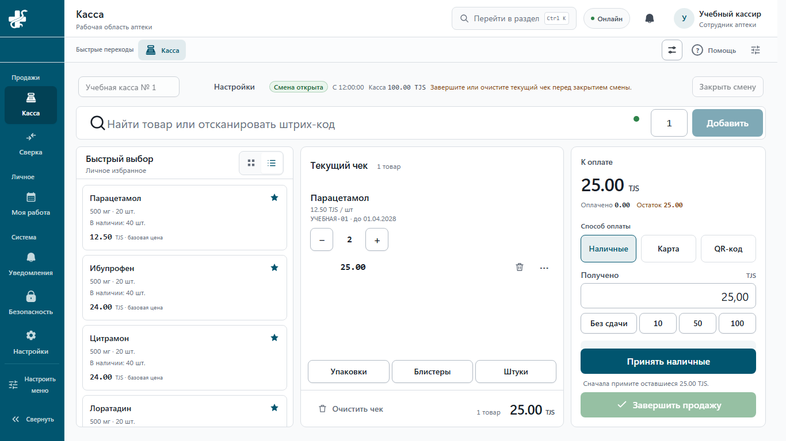

# Aurum Pharma

Aurum Pharma — веб-приложение для аптек Таджикистана. Сотрудник принимает поставку, связывает позиции накладной с каталогом и проводит товар на склад. Кассир продаёт лекарства упаковками, блистерами или поштучно. Интерфейс на русском языке, расчёты в сомони (TJS).

**Статус проекта.** Разработка приостановлена. Приложение демонстрировалось на учебных данных. Коммерческий запуск и пилот в реальной аптеке остаются отдельными этапами.



## Как работает поштучная касса

На начало учебной смены у аптеки 60 таблеток. Кассир продаёт три таблетки, затем блистер из десяти и целую упаковку из тридцати. После каждой продажи система сверяет остаток партии: 57, 47 и 17 таблеток. Дальше кассир оформляет частичный возврат, сотрудник склада списывает две повреждённые таблетки из вскрытого блистера, а кассир сверяет наличные при закрытии смены. Тест проходит через два окна браузера. В одном кассир работает с кассой своего филиала, в другом сотрудник с доступом к складу оформляет списание. [Сквозной тест смены](frontend/e2e/online-cash-rehearsal.spec.ts)

| Что происходит в аптеке | Как это проверяется |
| --- | --- |
| В накладной поставщика встречается новый товар. Сотрудник создаёт карточку и штрихкод прямо из строки приёмки. После потери ответа введённые данные сохраняются. | [Приёмка и каталог в браузере](frontend/e2e/incoming-catalog-create.spec.ts) |
| На складе несколько партий. При подборе касса учитывает ближайший срок годности и пропускает просроченные и заблокированные партии. | [Тест подбора партии](backend/tests/domains/pos/test_physical_cash_fefo_acceptance.py) |
| Запись оплаты прерывается. Повторная попытка восстанавливает операцию с прежним идентификатором и сохраняет последовательность чеков. | [Тест восстановления оплаты](backend/tests/domains/pos/test_physical_cash_payment_recovery.py) |
| При частичном возврате сумма должна учитывать скидку до последнего дирама. Завершённая продажа сохраняется в истории. | [Расчёт возврата](backend/tests/domains/pos/test_physical_cash_refund_acceptance.py) · [Защита истории в БД](backend/tests/isolation/test_completed_sale_immutability.py) |

## Устройство проекта

Касса, склад, приёмка и каталог оформлены как домены одного приложения на FastAPI. PostgreSQL хранит операции и применяет политики доступа к строкам таблиц для изоляции аптек. Интерфейс написан на React и TypeScript, сборка — Vite. Фоновые задачи выполняют Celery и Redis. Загружаемые файлы хранятся в MinIO.

[Домены backend](backend/app/domains/) · [Компоненты интерфейса](frontend/src/features/) · [Тест изоляции поставщиков](backend/tests/isolation/test_suppliers_incoming_rls.py) · [Сборка и проверки CircleCI](.circleci/config.yml)

## С чего начать разработчику

1. [Карта проекта](docs/project-structure.md) — ответственность папок и первый
   рабочий цикл; существующие пути отделены от планируемых.
2. [Текущее состояние](docs/development-state.md) и
   [известные проблемы](docs/known-issues.md) — реализация, проверки и риски.
3. [План развития](docs/implementation-roadmap.md) — сайт, Cloud, локальная
   касса, Windows-клиент, установщик и условия запуска пилота.
4. [Индекс контекста](docs/ai-context-index.md) — где найти относящийся к задаче
   код, тесты и документы; [ADR](docs/adr/README.md) — принятые решения.

## Запуск текущего main demo на Windows

Нужны Git и работающий Docker Desktop. Команды выполняются из корня checkout.
Сначала проверить план запуска, затем обновить demo из `main` без пересоздания
или наполнения общей базы:

```powershell
.\scripts\start-current-main-demo.ps1 -DryRun -Rebuild -SkipSeed -NoBrowser
.\scripts\start-current-main-demo.ps1 -Rebuild -SkipSeed -NoBrowser
```

Launcher обновляет `origin/main` (при недоступности GitHub использует его
локальную копию), а не незакоммиченные изменения рабочей ветки,
подготавливает отдельный runtime внутри workspace и применяет миграции вверх.
`SkipSeed` обязателен для существующей общей dev/demo-базы. Прерванный запуск
диагностировать по его ошибке; удаление томов, downgrade или принудительный seed
не являются способом починки.

- Приложение: <http://localhost:5173>.
- Launcher проверяет доступность API, frontend и gateway после запуска.
- Отдельный стандартный dev Compose и его smoke описаны в
  [docs/local-demo.md](docs/local-demo.md). Это другой профиль: не запускать
  его поверх current-main demo на тех же портах.

`SkipSeed` не наполняет новую среду демонстрационными данными. Первичное
наполнение отдельной новой среды и работа с общей существующей базой — разные
операции; перед наполнением проверить назначение окружения. Для проверки
изменений своей ветки использовать изолированные окружения из
[docs/testing.md](docs/testing.md), а не считать main demo этой веткой.

## Запуск публичного сайта

Нужен доступный Node.js; сайт использует встроенные модули и не требует установки
новых пакетов. Из корня проекта:

```powershell
node website/scripts/test.mjs
node website/scripts/build.mjs
node website/scripts/serve.mjs
```

Предпросмотр: <http://127.0.0.1:4174>. По умолчанию вход ведёт к локальному
приложению `http://localhost:5173/login`; оно запускается отдельно.
Сайт не подключается к базе данных и не заменяет launcher приложения.

Для production-сборки оператор задаёт `APP_URL` равным реальному HTTPS адресу
входа и выполняет:

```powershell
node website/scripts/build.mjs --production
```

Без корректного `APP_URL` production-сборка завершается ошибкой. Сборка создаёт
`website/dist/`, но сама ничего не публикует на домене. Подробности границы:
[ADR-0041](docs/adr/0041-public-website-boundary.md).

## Компоненты

| Путь | Назначение |
|---|---|
| `backend/` | FastAPI/PostgreSQL, бизнес-правила, авторизация, задачи и синхронизация |
| `frontend/` | Общий рабочий интерфейс React/TypeScript/Vite |
| `website/` | Независимый публичный сайт и способы установки |
| `infra/` | Конфигурация окружений, безопасность сервисов, backup/restore |
| `scripts/` | Запуск, диагностика и межкомпонентные проверки |
| `docs/` | Архитектура, план, состояния, runbooks и внешний допуск |
| `.circleci/` | Основной набор проверок PR и обязательный CI gate |

`desktop/AurumPharma.Desktop/` — **планируемый**, ещё не готовый компонент.
Схема клиента описана в [desktop blueprint](docs/desktop-host-implementation.md).
Установка веб-приложения на главный экран не означает наличие автономной кассы.

## Проверки и публикация

```powershell
.\scripts\verify-change.ps1 -Mode Auto -PlanOnly
```

Далее — проверки по выданному плану и [docs/testing.md](docs/testing.md).
Изменения идут через `codex/*`, PR и успешный обязательный CI gate.
Общую dev-БД нельзя удалять, очищать или пересоздавать.

Будущий Cloud развёртывается по
[production deployment runbook](docs/runbooks/production-deployment.md).
Публикация сайта и реальный запуск аптек — разные этапы: для пилота обязательны
[security release plan](docs/security-release-plan.md) и
[пилотный допуск](docs/compliance/pilot-legal-gate.md).

Продуктовый замысел: [spec-v3.md](docs/spec-v3.md), схема:
[db-schema-v2.md](docs/db-schema-v2.md). Исторический
[handoff.md](docs/handoff.md) не является доказательством текущей готовности.
